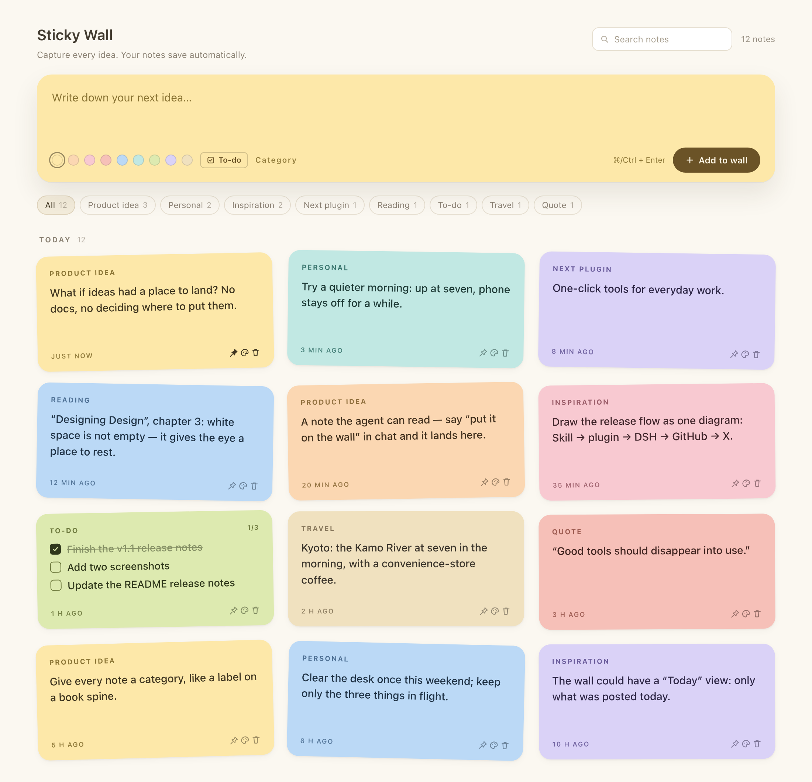

# Sticky Wall · dsh-sticky-wall

A DeepSeek Harness (DSH) UI plugin: **a sticky-note wall pinned to the left sidebar.** Capture an
idea in one line, color and categorize it, archive it, or turn it into a to-do — and let the agent
read and write the wall through tools.

[](https://github.com/bingomu/dsh-sticky-wall/releases)
[](https://github.com/bingomu/dsh-sticky-wall/blob/main/LICENSE)
[中文](README.md)



> Interface preview; the dark version is [`design/demo-en-dark.png`](https://github.com/bingomu/dsh-sticky-wall/blob/main/design/demo-en-dark.png).

## Features

- **Sidebar entry**: a sticky-note icon in the left rail opens the wall in the main panel.
- **Composer**: one warm-yellow paper card; write a line and press `⌘/Ctrl + Enter` (or “Add to wall”).
  Nine paper colors, optional category. Each new note picks a fresh random color; a manually
  picked color applies to the current note only.
- **To-dos**: the “To-do” toggle at the bottom of the composer turns a new note into a checklist —
  one item per line, with checkboxes and progress. Switch between note and to-do in edit mode.
  Checked state uses stable item ids, so inserting, reordering or rewording keeps it.
- **Category chips**: filter the wall by category (including uncategorized) with counts.
- **Time sections**: Today / This week / Earlier; “Earlier” is collapsed by default. Search or a
  category filter switches to a flat result list.
- **Archive**: put notes away manually and restore or delete them from the Archive view.
- **Undo delete**: 6 seconds to undo; the note comes back with its id, checkmarks and archive state.
- **Agent tools**: ask “put this on my sticky wall” or “what’s on the wall?” and the model can do it.
- **Local-first**: no network requests, no account; one JSON file on this machine.
- UI language follows the host (English / Chinese); light and dark follow the host theme.

## Install

Requires DSH `0.2.1-rc.2` or newer (tested on `0.2.1-rc.5`). The plugin is distributed via GitHub:

```bash
dsh plugin --profile <your-profile> add https://github.com/bingomu/dsh-sticky-wall/archive/refs/tags/v1.0.0.tar.gz
```

You can also open DSH Settings → Plugins and install from that tarball URL. After installing,
**restart DSH and refresh the page**; the sticky-note icon in the left rail means it worked.

To upgrade, reinstall with the tarball URL of the new tag. To uninstall, see below.

## Usage

1. Click the sticky-note icon in the left rail.
2. Write a line in the warm-yellow card, pick a color (optionally a category), and press
   `⌘/Ctrl + Enter` or “Add to wall”.
3. Click a note’s text to edit it in place; the bottom row pins, recolors, archives or tears it off.
4. To turn a note into a to-do: open edit mode and click “To-do” next to the category. One item per
   line; checkboxes remember completion.
5. The search box filters text and categories; category chips narrow the wall; “Archive N” shows
   notes you put away.

## Data and privacy

- Data lives in `~/.dsh/sticky-wall/notes.json` (`DSH_HOME` wins when set).
- Everything is local; the plugin makes no network requests and never uploads note content.
- The old `~/.dsh/notes` directory is copied once on first start; the old file is kept as a backup.
- A corrupt file is backed up as `notes.json.corrupt-<timestamp>` before starting empty.
- To back up or migrate, copy that JSON file.

## Agent tools

| Tool | Purpose |
| --- | --- |
| `sticky_wall_add` | Add a note (`text`, optional `color`, `category`, `kind: 'todo'`) |
| `sticky_wall_list` | Read the wall; filter by `query` / `category`, `includeArchived`, `limit` |
| `sticky_wall_remove` | Tear off a note by id |

## Uninstall

```bash
dsh plugin --profile <your-profile> remove dsh-sticky-wall
```

Uninstalling does not delete `~/.dsh/sticky-wall/notes.json`; delete that file to start over.

## Development

See [DEVELOPMENT.md](https://github.com/bingomu/dsh-sticky-wall/blob/main/DEVELOPMENT.md). Tests and syntax checks:

```bash
npm test
npm run check
```

## License

[MIT](https://github.com/bingomu/dsh-sticky-wall/blob/main/LICENSE) © 2026 Genzo
