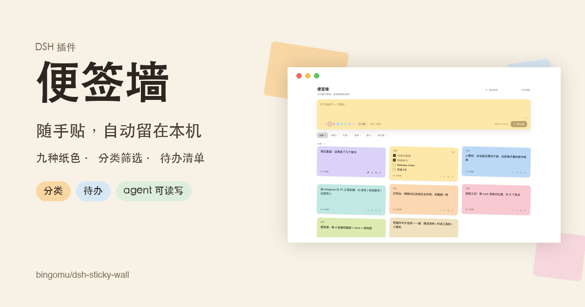
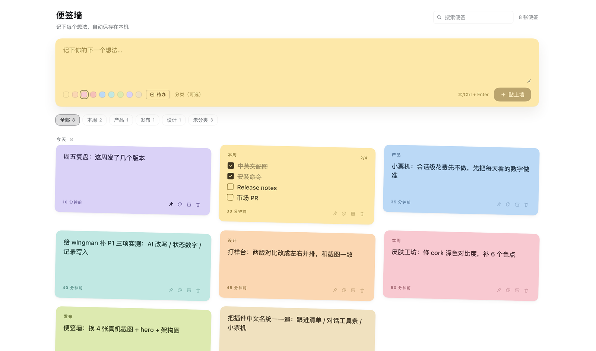
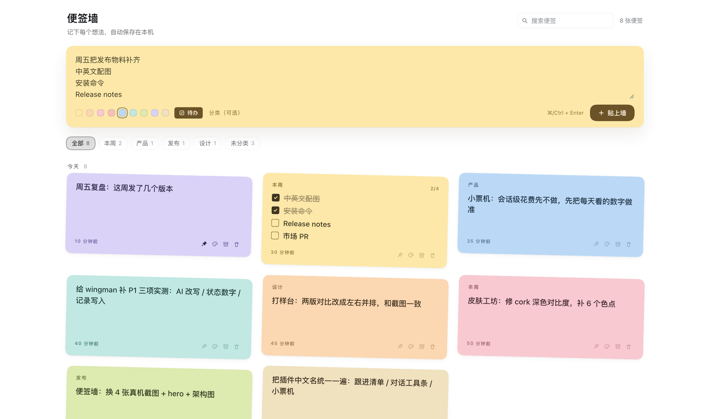
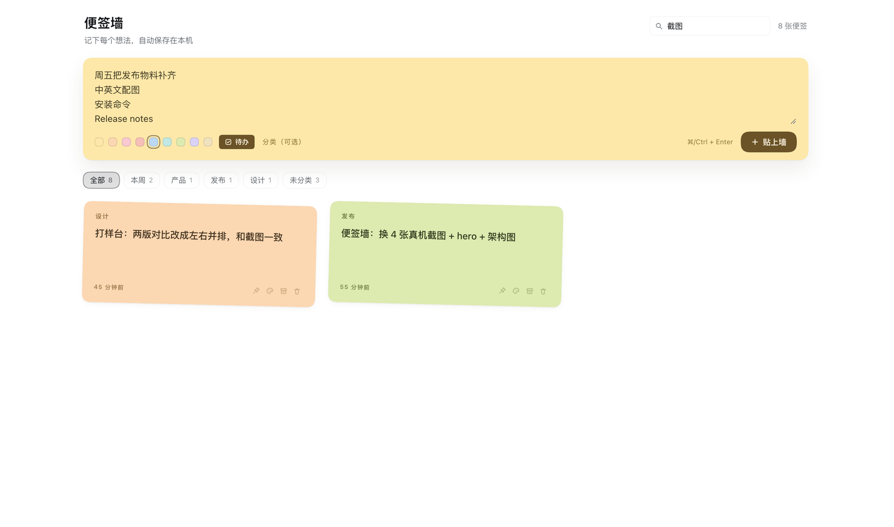
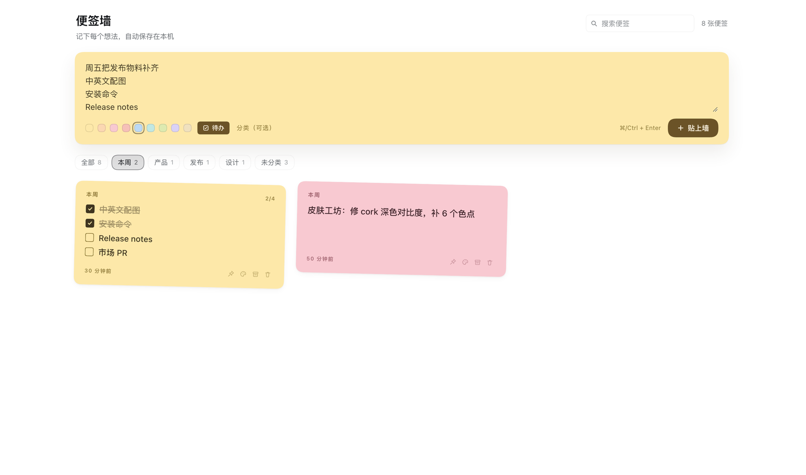

# 便签墙 · dsh-sticky-wall

DSH（DeepSeek Harness）会话界面插件：**左侧边栏常驻一面便签墙，随手把想法贴成彩色便签。**
便签可以分类、筛选、置顶、归档，也能一键变成待办；同时 agent 可以直接读写这面墙。

[](https://github.com/bingomu/dsh-sticky-wall/releases)
[](https://github.com/bingomu/dsh-sticky-wall/blob/main/LICENSE)
[English](README.en.md)



| 便签墙总览 | 输入 + 待办 |
|---|---|
|  |  |
| **搜索**：按文字过滤整面墙 | **分类筛选**：点 chips 只看一类 |
|  |  |

> 四张都是真实 DSH 界面截图（演示数据），不是设计稿。

## 功能

- **入口**：左侧边栏图标栏里的便签图标，点开在中间主面板打开整面墙。
- **输入**：一张暖黄色便签纸，写一句 `⌘/Ctrl + Enter` 贴上墙；九种纸色、可选分类。
  纸色默认随机（不会每次都停在同一个），手动选色只作用于当前这张。
- **待办**：输入卡底部「待办」开关让新便签变成待办；正文一行一条，可勾选、显示进度；
  编辑态里可在「便签 ⇄ 待办」之间转换。勾选状态用稳定条目 id 保存，插入/重排/改写尽量不丢。
- **分类筛选**：墙上一行分类 chips（全部 / 各分类 / 未分类），带数量。
- **时间分区**：今天 / 本周 / 更早，更早默认收起；搜索或筛选时平铺结果。
- **归档**：手动把暂时不看的便签收进归档，随时取出或删除。
- **删除撤销**：撕掉后有 6 秒撤销，恢复时保留 id、勾选与归档状态。
- **agent 工具**：在对话里说「记到便签墙」「便签墙上有什么」，模型可以读写。
- **本地优先**：没有网络请求、没有账号；数据是一个本机 JSON 文件。
- 界面语言跟随宿主（中文 / English），亮暗主题跟随宿主。

## 安装

需要 DSH `0.2.1-rc.2` 及以上（已在 `0.2.1-rc.5` 测试）。本插件通过 GitHub 发布：

```bash
dsh plugin --profile <你的 profile> add https://github.com/bingomu/dsh-sticky-wall/releases/latest/download/dsh-sticky-wall.tgz
```

也可以打开 DSH 设置 → 插件，用「安装」入口填这个 tarball URL。安装后**重启 DSH 并刷新页面**，
左侧边栏出现便签图标即成功。

升级：把上面的 URL 换成新版本 tag 的 tarball 地址重新安装；卸载见下。

## 使用

1. 点左侧边栏的便签图标，打开便签墙。
2. 在顶部黄色便签纸里写一句，选纸色（可填分类），按 `⌘/Ctrl + Enter` 或点「贴上墙」。
3. 点击便签正文就地编辑；底部一行小操作可以置顶、换色、归档、撕掉。
4. 想把便签变成待办：打开编辑态，点分类右边的「待办」；每行一条，勾选框会记住完成状态。
5. 搜索框即时过滤正文与分类；分类 chips 只看某一类；「归档 N」查看收起来的便签。

## 数据与隐私

- 数据位置：`~/.dsh/sticky-wall/notes.json`（`DSH_HOME` 优先）。
- 全部本地读写；插件不发起任何网络请求，不上传便签内容。
- 旧版本目录 `~/.dsh/notes` 会在首次启动时自动复制到新目录一次，旧文件保留作备份。
- 文件损坏时会先备份成 `notes.json.corrupt-<时间戳>`，再从空墙开始。
- 备份/迁移：直接复制这个 JSON 文件即可。

## agent 工具

| 工具 | 作用 |
| --- | --- |
| `sticky_wall_add` | 贴一张便签（`text`，可选 `color`、`category`、`kind: 'todo'`） |
| `sticky_wall_list` | 读墙，可按 `query` / `category` 过滤、`includeArchived` 含归档、`limit` 限制 |
| `sticky_wall_remove` | 按 id 撕掉一张便签 |

## 卸载

```bash
dsh plugin --profile <你的 profile> remove dsh-sticky-wall
```

卸载不会删除 `~/.dsh/sticky-wall/notes.json`。想彻底清空，删除该文件即可。

## 开发

见 [DEVELOPMENT.md](https://github.com/bingomu/dsh-sticky-wall/blob/main/DEVELOPMENT.md)。测试与语法检查：

```bash
npm test
npm run check
```

## License

[MIT](https://github.com/bingomu/dsh-sticky-wall/blob/main/LICENSE) © 2026 Genzo
